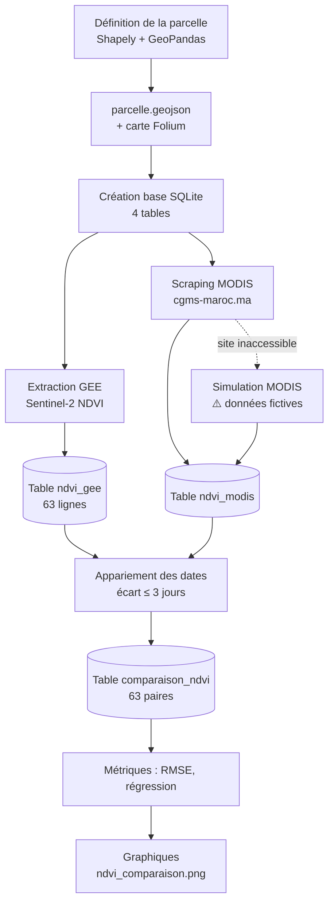
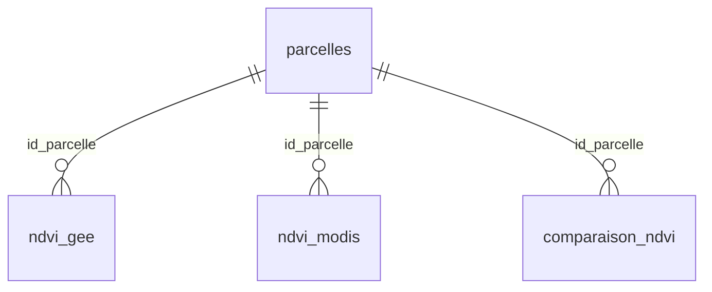
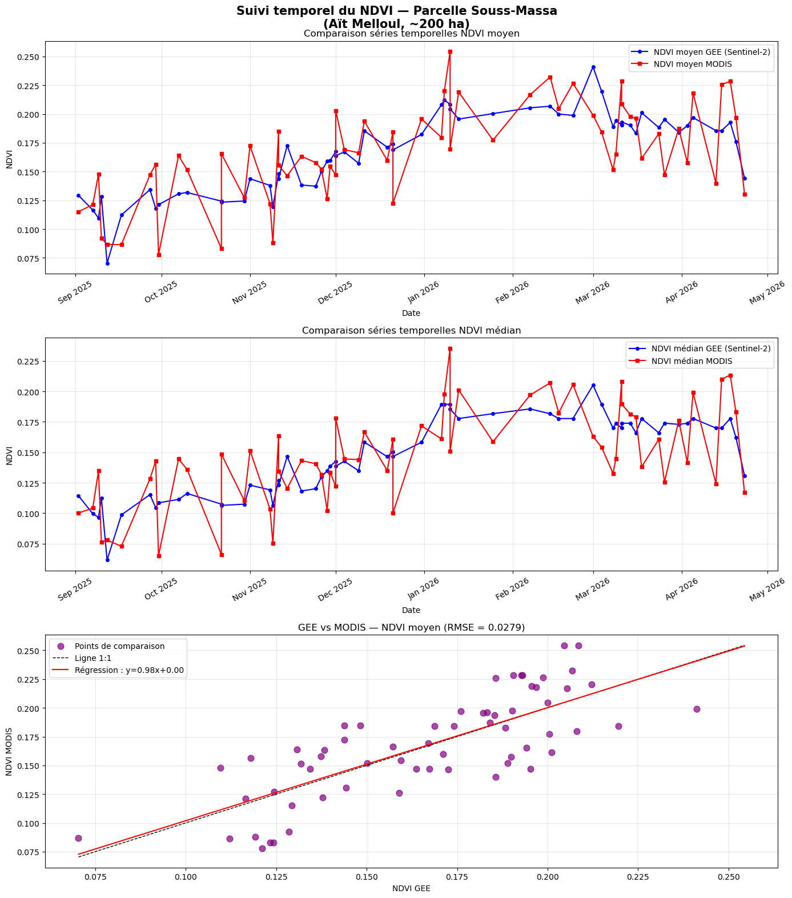

# 🌱 Suivi du NDVI d'une parcelle agricole — Souss-Massa (Maroc)

**Pipeline Python de télédétection : Sentinel-2 (Google Earth Engine) vs MODIS, stockage SQLite et analyse comparative**


> **Auteur :** Abdelhamid Ellaoui — Projet *Python Avancé*

---

## ⚠️ Note importante sur les données MODIS

Lors de l'exécution du notebook, le site `cgms-maroc.ma` était **inaccessible** : le scraping a retourné **0 fichier MODIS**.
Pour pouvoir terminer et tester le pipeline, les valeurs MODIS ont été **simulées** à partir des valeurs GEE (bruit uniforme de ±0,05 sur la moyenne et la médiane).

**Conséquence :** les métriques d'erreur (RMSE, biais, corrélation) présentées plus bas **ne reflètent pas une vraie différence entre capteurs**. Elles valident le fonctionnement du code, pas la qualité de l'accord Sentinel-2 / MODIS.
Les données GEE (Sentinel-2), elles, sont **réelles**.

---

## 📑 Sommaire

1. [Contexte et objectifs](#-contexte-et-objectifs)
2. [Zone d'étude](#-zone-détude)
3. [Sources de données](#-sources-de-données)
4. [Pipeline](#-pipeline)
5. [Démarche détaillée](#-démarche-détaillée)
6. [Base de données](#-base-de-données)
7. [Résultats](#-résultats)
8. [Interprétation](#-interprétation)
9. [Limites](#-limites)
10. [Installation et exécution](#-installation-et-exécution)
11. [Structure du dépôt](#-structure-du-dépôt)
12. [Perspectives](#-perspectives)

---

## 🎯 Contexte et objectifs

Le **NDVI** (*Normalized Difference Vegetation Index*) est l'indice de végétation le plus utilisé en agriculture de précision :

```
NDVI = (PIR − Rouge) / (PIR + Rouge)        →  Sentinel-2 : (B8 − B4) / (B8 + B4)
```

Ce projet vise à :

- définir une **parcelle agricole** de la région Souss-Massa et la stocker au format GeoJSON ;
- extraire une **série temporelle NDVI** Sentinel-2 via Google Earth Engine (sept. 2025 → mai 2026) ;
- récupérer des **cartes NDVI MODIS** par scraping et les découper sur la parcelle ;
- **centraliser** les résultats dans une base **SQLite** relationnelle ;
- **comparer** les deux sources (RMSE, régression, nuage de points) et visualiser le tout.

## 📍 Zone d'étude

| Élément | Valeur |
|---|---|
| Région | Souss-Massa, secteur d'Aït Melloul |
| Emprise (WGS84) | lon −9,560 → −9,540 ; lat 30,310 → 30,325 |
| Superficie calculée (EPSG:32629, UTM 29N) | **≈ 319,6 ha** |
| Type de géométrie | Polygone rectangulaire défini manuellement |
| Fichiers produits | `parcelle.geojson`, `parcelle_map.html` (carte Folium) |

> Le titre des graphiques mentionne « ~200 ha », mais la superficie réellement calculée par le code est de 319,6 ha.

## 🛰️ Sources de données

| Source | Produit | Résolution spatiale | Accès | Statut dans ce projet |
|---|---|---|---|---|
| **Google Earth Engine** | `COPERNICUS/S2_SR_HARMONIZED` (Sentinel-2 L2A) | 10 m | API `earthengine-api` | ✅ Données réelles (63 images) |
| **MODIS (CGMS Maroc)** | Cartes NDVI GeoTIFF | ~250 m | Scraping `requests` + `BeautifulSoup` | ❌ Site inaccessible → données simulées |

Filtres appliqués à Sentinel-2 : période `2025-09-01 → 2026-05-02`, couverture nuageuse `< 20 %`, emprise = parcelle.

## 🔄 Pipeline



## 🧭 Démarche détaillée

### Étape 1 — Définition de la parcelle
- Polygone construit avec **Shapely**, encapsulé dans un **GeoDataFrame** (CRS `EPSG:4326`).
- Export en **GeoJSON**.
- Reprojection en **EPSG:32629** (UTM 29N) pour un calcul de superficie en mètres.
- Carte interactive **Folium** exportée en `parcelle_map.html`.

### Étape 2 — Modélisation de la base de données SQLite
Création de `ndvi_projet.db` avec quatre tables liées par clé étrangère (voir [Base de données](#-base-de-données)). La géométrie de la parcelle est stockée en **WKT**.

### Étape 3 — Extraction du NDVI Sentinel-2 via Google Earth Engine
1. Authentification et initialisation (`ee.Authenticate()`, `ee.Initialize(project=...)`).
2. Filtrage de la collection `COPERNICUS/S2_SR_HARMONIZED`.
3. Calcul du NDVI par image : `normalizedDifference(['B8','B4'])`.
4. `reduceRegion` sur la parcelle (échelle 10 m) avec cinq réducteurs : **moyenne, médiane, min, max, écart-type**.
5. Rapatriement des valeurs avec `reduceColumns(...).getInfo()` et insertion dans `ndvi_gee`.

### Étape 4 — Récupération des cartes MODIS
1. Scraping de la page d'index pour lister les fichiers `.tif` / `.tiff` datés depuis sept. 2025.
2. Téléchargement en flux (`stream=True`) avec reprise si le fichier existe déjà.
3. Découpage du raster sur la parcelle (`rasterio.mask`), reprojection dans le CRS du raster.
4. Masquage des *no-data* et application du facteur d'échelle MODIS (×0,0001) si nécessaire.
5. Calcul des cinq statistiques et insertion dans `ndvi_modis`.

> Résultat réel : **0 fichier trouvé** (site inaccessible) → bascule sur la simulation décrite en début de document.

### Étape 5 — Comparaison GEE vs MODIS
- Pour chaque date Sentinel-2, recherche de la carte MODIS la plus proche dans le temps.
- Appariement conservé si l'**écart ≤ 3 jours**.
- Calcul de l'erreur `GEE − MODIS` sur la moyenne et la médiane, puis du **RMSE**.
- Résultats insérés dans `comparaison_ndvi`.

### Étape 6 — Visualisation
Figure à trois panneaux : séries temporelles (moyenne), séries temporelles (médiane), nuage de points GEE vs MODIS avec droite 1:1 et régression linéaire.

## 🗄️ Base de données

Fichier : `ndvi_projet.db` (SQLite)

| Table | Rôle | Colonnes principales |
|---|---|---|
| `parcelles` | Parcelle étudiée | `id_parcelle` (PK), `nom_etudiant`, `region`, `geom` (WKT) |
| `ndvi_gee` | NDVI Sentinel-2 | `date_image`, `ndvi_moyen`, `ndvi_median`, `ndvi_min`, `ndvi_max`, `ndvi_std`, `source` |
| `ndvi_modis` | NDVI MODIS | `date_carte`, `ndvi_moyen`, `ndvi_median`, `ndvi_min`, `ndvi_max`, `ndvi_std`, `source` |
| `comparaison_ndvi` | Paires GEE/MODIS | `date_gee`, `date_modis`, `ecart_jours`, `ndvi_moy_*`, `ndvi_med_*`, `erreur_moy`, `erreur_med` |



## 📊 Résultats

### Volume de données

| Indicateur | Valeur |
|---|---|
| Images Sentinel-2 retenues (nuages < 20 %) | **63** |
| Cartes MODIS réelles récupérées | 0 *(site inaccessible)* |
| Lignes MODIS simulées | 63 |
| Paires appariées (écart ≤ 3 jours) | 63 |

### NDVI Sentinel-2 (données réelles) — statistiques globales

| Statistique | NDVI moyen de la parcelle |
|---|---|
| Moyenne | 0,167 |
| Médiane | 0,173 |
| Écart-type | 0,034 |
| Minimum | 0,070 (12/09/2025) |
| Maximum | 0,241 (01/03/2026) |

### Évolution mensuelle du NDVI moyen (Sentinel-2)

| Mois | NDVI moyen | Nb d'images |
|---|---|---|
| Sept. 2025 | 0,116 | 9 |
| Oct. 2025 | 0,127 | 5 |
| Nov. 2025 | 0,146 | 11 |
| Déc. 2025 | 0,171 | 9 |
| Janv. 2026 | 0,205 | 6 |
| Févr. 2026 | 0,203 | 4 |
| Mars 2026 | 0,197 | 12 |
| Avr. 2026 | 0,182 | 7 |

### Comparaison GEE vs MODIS ⚠️ (MODIS simulé)

| Métrique | Valeur |
|---|---|
| RMSE — NDVI moyen | 0,0279 |
| RMSE — NDVI médian | 0,0278 |
| MAE — NDVI moyen | 0,0243 |
| Biais moyen (GEE − MODIS) | −0,0008 |
| Corrélation de Pearson | 0,77 |
| Régression linéaire | y = 0,98·x + 0,00 |

> Ces valeurs découlent d'un bruit **artificiel** de ±0,05 : elles sont attendues et n'ont pas de valeur scientifique.

### Extrait du tableau de comparaison (10 premières paires)

| Date GEE | Date MODIS | Écart (j) | NDVI moy. GEE | NDVI moy. MODIS | Erreur |
|---|---|---|---|---|---|
| 2025-09-02 | 2025-09-02 | 0 | 0,1293 | 0,1151 | 0,0142 |
| 2025-09-07 | 2025-09-07 | 0 | 0,1166 | 0,1213 | −0,0047 |
| 2025-09-09 | 2025-09-09 | 0 | 0,1096 | 0,1479 | −0,0383 |
| 2025-09-10 | 2025-09-10 | 0 | 0,1285 | 0,0923 | 0,0362 |
| 2025-09-12 | 2025-09-12 | 0 | 0,0704 | 0,0868 | −0,0164 |
| 2025-09-17 | 2025-09-17 | 0 | 0,1122 | 0,0864 | 0,0258 |
| 2025-09-27 | 2025-09-27 | 0 | 0,1343 | 0,1472 | −0,0129 |
| 2025-09-29 | 2025-09-29 | 0 | 0,1180 | 0,1563 | −0,0383 |
| 2025-09-30 | 2025-09-30 | 0 | 0,1212 | 0,0778 | 0,0434 |
| 2025-10-07 | 2025-10-07 | 0 | 0,1307 | 0,1639 | −0,0332 |

*Le tableau complet (63 lignes) est stocké dans la table `comparaison_ndvi`.*

### Graphiques



*Haut : NDVI moyen. Milieu : NDVI médian. Bas : nuage de points GEE vs MODIS avec droite 1:1 et régression.*

## 🔍 Interprétation

- **Dynamique saisonnière (données Sentinel-2 réelles)** : le NDVI moyen passe de ≈ 0,12 en septembre à ≈ 0,20 en janvier–février, puis se stabilise en mars et recule en avril. Cela traduit un développement progressif de la végétation sur la parcelle durant l'hiver, suivi d'un repli en fin de période.
- **Niveau du NDVI** : les valeurs restent modérées (0,07 à 0,24). Elles sont cohérentes avec un couvert végétal partiel ou clairsemé sur l'ensemble du polygone, sans pouvoir préciser le type de culture sans données de terrain.
- **Moyenne vs médiane** : les deux courbes sont très proches, ce qui suggère une distribution des pixels assez homogène dans la parcelle.
- **GEE vs MODIS** : aucune conclusion sur l'accord entre capteurs ne peut être tirée, puisque les données MODIS sont simulées. En revanche, avec de vrais produits MODIS, il faudrait s'attendre à des écarts liés à la résolution (10 m contre ~250 m) et aux effets de mélange en bordure de parcelle.

## 🚧 Limites

1. **MODIS simulé** : point principal, voir l'avertissement en tête de document.
2. **Superficie** : 319,6 ha calculés, alors que les titres indiquent ~200 ha.
3. **Parcelle rectangulaire** définie à la main, sans lien avec un parcellaire réel.
4. **Doublons de dates** : certaines dates Sentinel-2 apparaissent deux fois (tuiles différentes), ce qui produit des paires redondantes.
5. **Aucune validation terrain** ni masque de nuages au niveau du pixel (filtre uniquement au niveau de la scène).

## ⚙️ Installation et exécution

### Prérequis
- Python 3.10+
- Un compte **Google Earth Engine** et un projet Google Cloud activé pour l'API

### Installation

```bash
git clone https://github.com/<votre-utilisateur>/<nom-du-depot>.git
cd <nom-du-depot>

python -m venv .venv
# Windows
.venv\Scripts\activate
# macOS / Linux
source .venv/bin/activate

pip install -r requirements.txt
```

### Exécution

1. Ouvrir `Projet_Python_Avance.ipynb` dans VS Code ou Jupyter.
2. Remplacer l'identifiant de projet GEE (`ee.Initialize(project='...')`) par le vôtre.
3. Lancer `ee.Authenticate()` une première fois (connexion Google dans le navigateur).
4. Exécuter les cellules dans l'ordre : parcelle → base de données → GEE → MODIS → comparaison → graphiques.

## 📁 Structure du dépôt

```
.
├── Projet_Python_Avance.ipynb   # Notebook principal (pipeline complet)
├── README.md
├── requirements.txt
├── .gitignore
└── images/
    └── ndvi_comparaison.png     # Figure de synthèse
```

Fichiers générés à l'exécution (ignorés par Git) : `ndvi_projet.db`, `parcelle.geojson`, `parcelle_map.html`, `modis_tiffs/`.

## 🚀 Perspectives

- Remplacer la simulation par de **vraies données MODIS** (par ex. produit MOD13Q1 via GEE) et recalculer RMSE, biais et corrélation.
- Utiliser une **parcelle réelle** (cadastre ou digitalisation sur image) et vérifier la superficie.
- Ajouter un **masque de nuages pixel par pixel** (bande SCL ou QA60).
- Dédoublonner les dates Sentinel-2 (agrégation par jour).
- Étendre à **plusieurs parcelles** et plusieurs campagnes agricoles, ajouter d'autres indices (EVI, NDWI).

---

*Projet réalisé dans le cadre du cours Python Avancé.*
